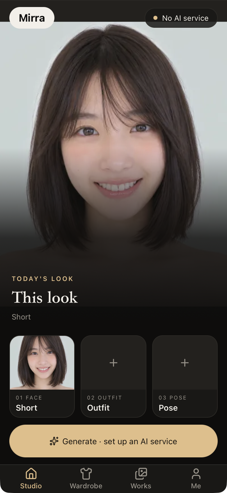
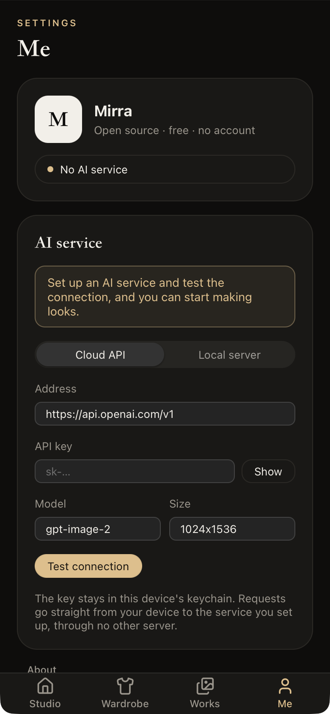
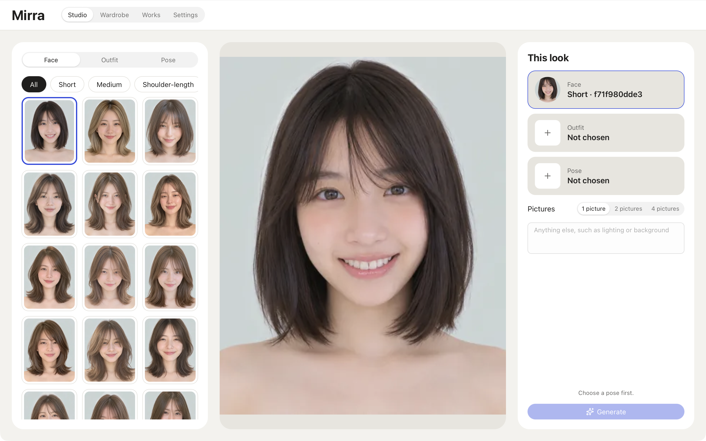
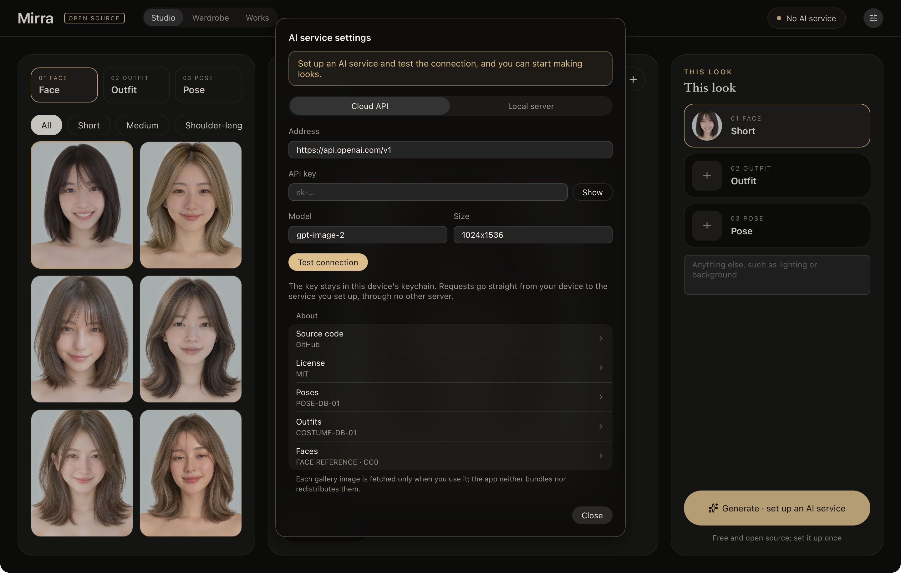

<p align="center">
  
</p>

<h1 align="center">Mirra 镜衣</h1>

<p align="center">
  <strong>English</strong> |
  <a href="README.zh-CN.md">简体中文</a>
</p>

<p align="center">
  Put a face, an outfit and a pose from three reference galleries together, and let an image model draw the person they describe. Built in Go with <a href="https://github.com/nsgo-dev/nsgo">NSGo</a>, which draws it with each platform's own views; one codebase builds for macOS, iOS, Android and Windows.
</p>

<p align="center">
  
  
</p>

<p align="center">
  
</p>

<p align="center">
  
</p>

## What it does

- **Face, outfit, pose.** Choose a face (AI-generated, CC0), an outfit (clothes with no one wearing them) and a pose (a faceless gray mannequin), and the app asks an image model for a photo of one adult person with them. Only the pose is required.
- **Two layouts.** In a window narrower than 900 points, the phone layout: Studio, Wardrobe, Works and Me over a tab bar, with the look put together in three steps. Wider, the desktop studio: the galleries on the left, a zoomable canvas with the look or its result in the middle, the summary and Generate on the right, and the AI service in a dialog.
- **Filters that match the galleries.** Faces by hair length, outfits by season and occasion, poses by camera angle.
- **A result you decide on.** A new picture waits until you save it to Works. Generate it again, or put another outfit on the same face and pose with one tap; star it, export it or delete it.
- **Wardrobe.** Keep outfits you like with ♡, add photos of your own clothes laid flat or on a hanger, and see what the look is wearing.
- **Lookbook.** Saved pictures are numbered, can be starred, and open again with the look they were made from.
- **Cloud or local.** Any OpenAI-compatible image editing endpoint (`POST /images/edits`): a cloud API with a key, or a server you run, where the key may be left out. Test the connection before generating; the key is kept in the system keychain.
- **Extra instructions.** Add a line such as lighting or background, sent along with the prompt.
- **No photos of you.** The app takes no picture of a person: the pose and outfit galleries' terms forbid using their images to depict real people. Photos you add are of clothes only.
- English and Simplified Chinese.

## Where the references come from

| Slot | Gallery | Terms |
| --- | --- | --- |
| Pose | [POSE-DB-01](https://ai-pose-gallery.pages.dev) | Free to use, commercial use included; redistribution and bulk or automated downloading are not allowed |
| Outfit | [COSTUME-DB-01](https://ai-costume-gallery.pages.dev) | Same as above |
| Face | [FACE REFERENCE](https://ai-portrait-gallery.pages.dev) | CC0 |

The images belong to the galleries' authors. This repository contains none of them, and the app follows the galleries' terms:

- It reads each gallery's index live. Thumbnails load from the gallery while you browse, as they would in a browser; the app keeps no copy of its own, beyond the platform's image cache.
- A full-size image is downloaded only when you press Generate, and only the ones you chose, one each.
- It leaves out the pose gallery's two-person and explicit lines and the outfit gallery's lingerie and "sexy" categories.

The pose and outfit galleries ask that their images are not used to depict real people or minors, or for anything offensive, and the face gallery that its faces are not used to impersonate real people. Those terms bind what you make with this app; see [NOTICE.md](NOTICE.md).

## How it works

```
gallery index (HTML / JS)  ──►  catalog: id, group, title, thumbnail, full image
                                   │
  you choose a face, an outfit (or your own clothes) and a pose
                                   │
     full images (downloaded once) + prompt
                                   │
                POST {base URL}/images/edits  (multipart, image[] in order)
                                   │
          b64_json or url  ──►  shown; kept in Works when you save it
```

The images are sent pose first, then the outfit and the face, and the prompt numbers them in that order and says what each one is for: the mannequin's pose and camera angle, the outfit to put on, the face and hair to use.

| File | What is in it |
| --- | --- |
| [`gallery.go`](gallery.go) | Reading the three galleries' indexes and what is left out |
| [`generate.go`](generate.go) | The prompt and the `/images/edits` request |
| [`works.go`](works.go) | The lookbook: numbered pictures with their look and star in a sidecar |
| [`service.go`](service.go) | Cloud or local service and the connection test |
| [`wardrobe.go`](wardrobe.go) | Favorite outfits, your own clothes and what is being worn |
| [`app.go`](app.go) | The app's state, the choice of layout and generating |
| [`library.go`](library.go) | What both layouts share: a gallery's chips and grid, the look's rows, the preview |
| [`phone.go`](phone.go) | The phone layout and its three-step editor |
| [`desktop.go`](desktop.go) | The desktop studio's top bar and three columns |
| [`pages.go`](pages.go) | A result, Works and the AI service settings |
| [`theme.yaml`](theme.yaml) | The dark amber theme the app always shows |
| [`locales/`](locales) | English and Chinese messages |
| [`tools/appicon`](tools/appicon) | Draws `assets/Icon.png` |

## Run it

Requires Go 1.27.4 or later. On a Mac, which also builds the iOS and Android apps:

```sh
git clone https://github.com/yldm-ai/mirra
cd mirra
go tool nsgo dev                     # this machine
go tool nsgo dev -lang zh-Hans       # in Chinese
go tool nsgo dev -target ios_simulator
go tool nsgo dev -target android     # a connected device or emulator
go tool nsgo build                   # packages for every target in nsgo.yaml, into dist/
```

`go tool nsgo doctor` says which targets this machine can build and run.

### Set up the image API

Open **Me** on a phone, or the settings button at the top right on the desktop, choose **Cloud API** or **Local server**, fill in the fields and press **Test connection**, which asks the service for its models (`GET /models`).

| Field | Default | Notes |
| --- | --- | --- |
| Address | `https://api.openai.com/v1` (cloud), `http://127.0.0.1:8080/v1` (local) | Any OpenAI-compatible API, gateway or local server; the app appends `/images/edits` |
| API key | | Stored in the macOS / iOS keychain, Android Keystore or Windows Credential Manager; optional for a local server |
| Model | `gpt-image-2` | A model that takes several reference images |
| Size | `1024x1536` | Passed as `size` |

A local server has to speak the same OpenAI-compatible API; ComfyUI's own protocol, for one, is not supported. Each Generate is one call, paid on a cloud API. So far the request has been tested against the local fake in the tests, not against a real image API; reports of what a given model or gateway does with it are welcome.

## Platforms

| Platform | State |
| --- | --- |
| macOS | Runs; tested in a real window |
| iOS, Android, Windows | `nsgo build` packages them (an iOS Simulator app, an APK signed with the debug key, a Windows installer); not yet run on a device or simulator |
| Linux | Not in the build targets yet; NSGo supports it, untested here |
| Web | Not supported: the browser has no secure store for the API key (`cx.Secrets()` is unavailable there) |

## Privacy

- The app sends the service you set up only the images you chose (gallery images, or a photo of your clothes) and the prompt, and only when you press Generate or Test connection.
- Photos of your clothes stay in the app's data directory.
- The galleries see the requests for the thumbnails and images you open, as a browser visit would.
- A new picture is kept aside until you save it; saved ones stay in the app's data directory until you delete them.

## Development

```sh
go tool nsgo test .                                    # headless tests, with local fakes of the galleries and the API
go tool nsgo test -target macos .                      # the same tests in a real window
go tool nsgo check -target macos,ios,android,windows   # vet every target
go run ./tools/appicon                                 # redraw the icon
```

The tests never reach the network: `fixtures_test.go` serves made-up gallery pages in the galleries' formats and a fake `/images/edits`.

If a gallery changes its page format, the picker shows "Couldn't load the gallery" with the parser's error; the parsers are in `gallery.go`.

## License

The code is [MIT](LICENSE). The gallery images are not part of this repository and stay under their owners' terms.
