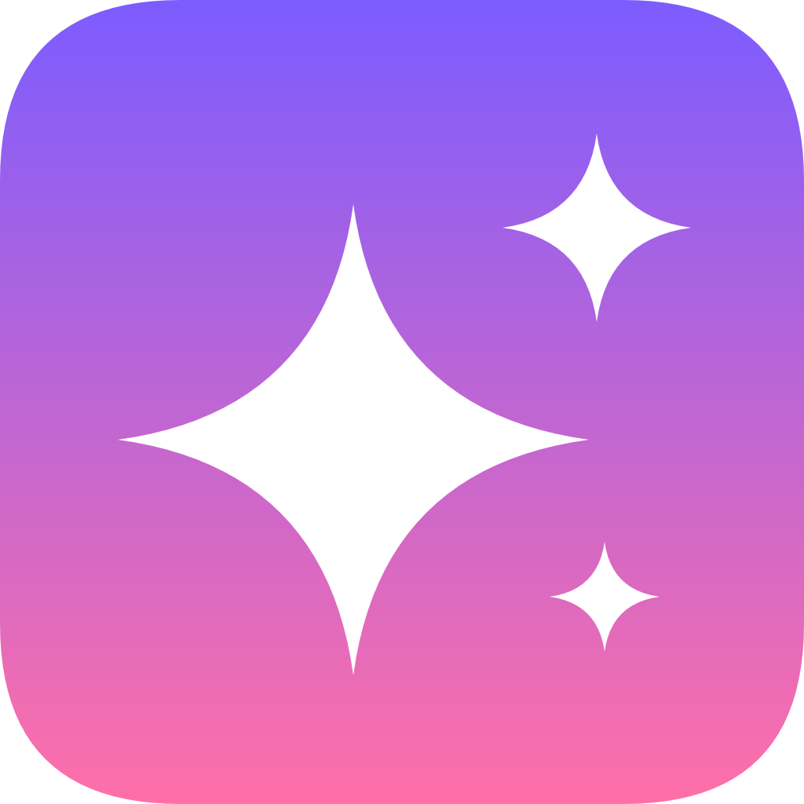
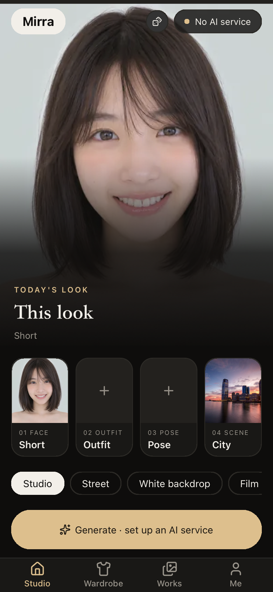
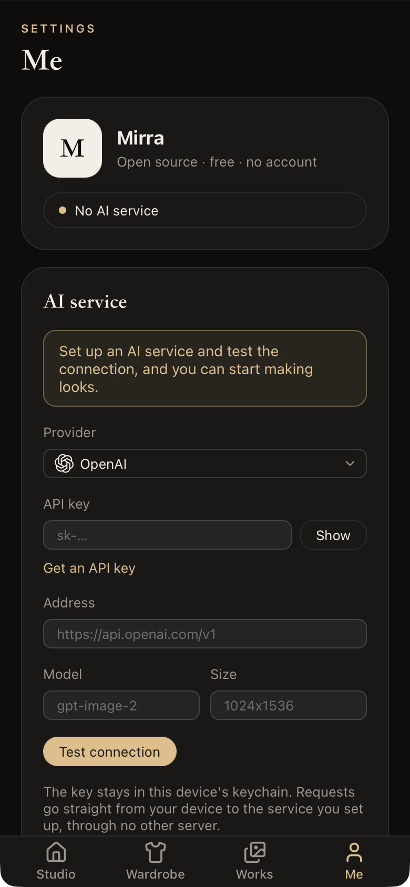
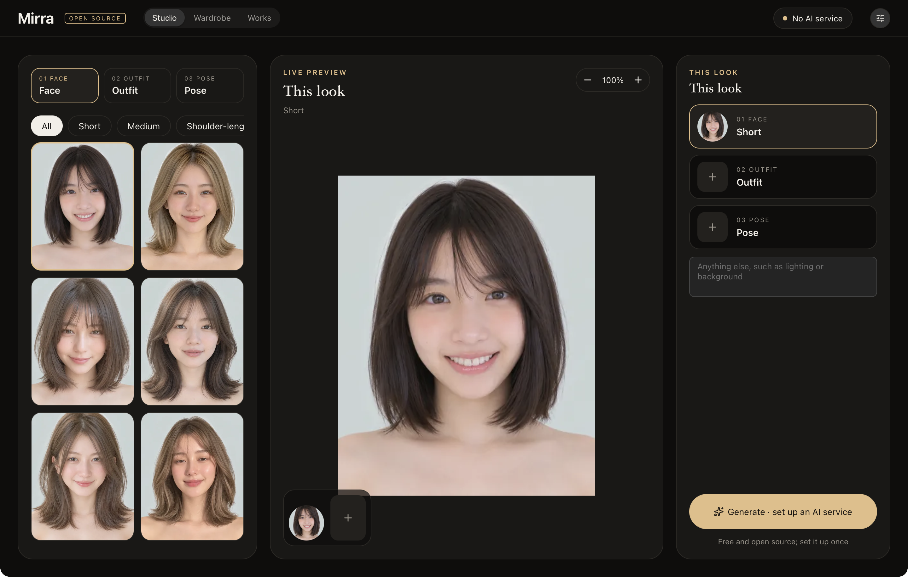
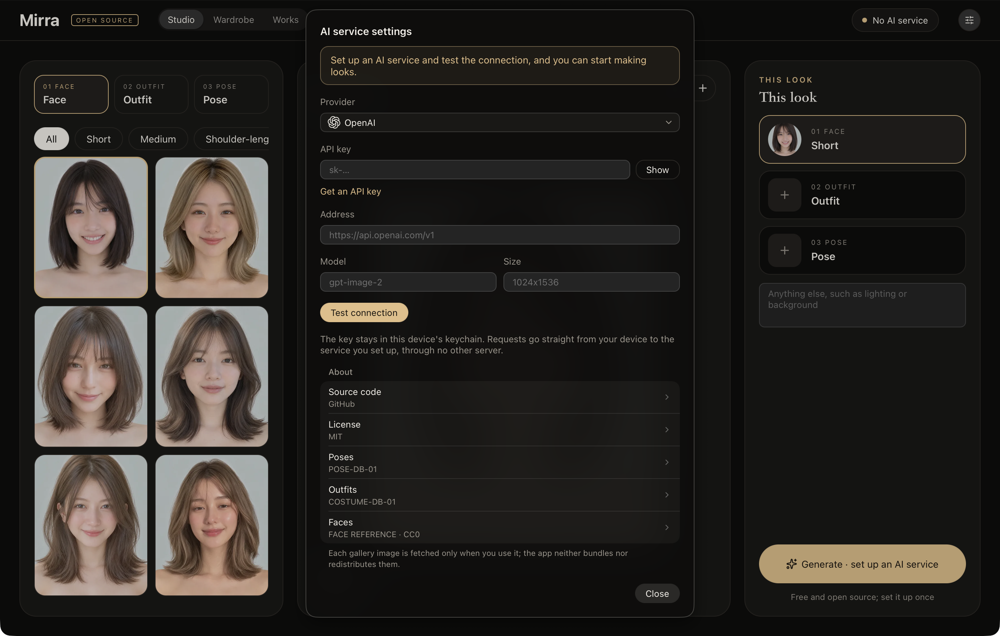

<p align="center">
  
</p>

<h1 align="center">Mirra 镜衣</h1>

<p align="center">
  <strong>English</strong> |
  <a href="README.zh-CN.md">简体中文</a>
</p>

<p align="center">
  Put a face, an outfit and a pose from three reference galleries together, and let an image model draw the person they describe. Built in Go with <a href="https://github.com/nsgo-dev/nsgo">NSGo</a>, which draws it with each platform's own views; one codebase builds for macOS, iOS, Android and Windows.
</p>

<p align="center">
  <a href="https://yldm-ai.github.io/mirra/">Website</a>
</p>

<p align="center">
  
  
</p>

<p align="center">
  
</p>

<p align="center">
  
</p>

## What it does

- **Face, outfit, pose.** Choose a face (AI-generated, CC0), an outfit (clothes with no one wearing them) and a pose (a faceless gray mannequin), and the app asks an image model for a photo of one adult person with them. Only the pose is required.
- **Two layouts.** In a window narrower than 900 points, the phone layout: Studio, Wardrobe, Works and Me over a tab bar, with the look put together in three steps. Wider, the desktop studio: the galleries on the left, a zoomable canvas with the look or its result in the middle, the summary and Generate on the right, and the AI service in a dialog.
- **Filters that match the galleries.** Faces by hair length, outfits by season and occasion, poses by camera angle. Lingerie, sexy outfits and revealing or two-person poses stay behind an 18+ switch, which asks your age first.
- **A result you decide on.** A new picture waits until you save it to Works. Generate it again, or put another outfit on the same face and pose with one tap; star it, export it or delete it.
- **Wardrobe.** Keep outfits you like with ♡, add photos of your own clothes laid flat or on a hanger, and see what the look is wearing.
- **Lookbook.** Saved pictures are numbered, can be starred, and open again with the look they were made from.
- **The main image providers, or your own server.** OpenAI, Google Gemini, Volcengine Ark, xAI, OpenRouter, Alibaba Cloud Model Studio and Azure OpenAI are preset, each with its logo and a link to get a key; stable-diffusion.cpp or any OpenAI-compatible address works too, with the key optional. Each provider keeps its own key and settings. Test the connection before generating; keys are kept in the system keychain.
- **Extra instructions.** Add a line such as lighting or background, sent along with the prompt.
- **No photos of you.** The app takes no picture of a person: the pose and outfit galleries' terms forbid using their images to depict real people. Photos you add are of clothes only.
- English and Simplified Chinese.

## Where the references come from

| Slot | Gallery | Terms |
| --- | --- | --- |
| Pose | [POSE-DB-01](https://ai-pose-gallery.pages.dev) | Free to use, commercial use included; redistribution and bulk or automated downloading are not allowed |
| Outfit | [COSTUME-DB-01](https://ai-costume-gallery.pages.dev) | Same as above |
| Face | [FACE REFERENCE](https://ai-portrait-gallery.pages.dev) | CC0 |

The images belong to the galleries' authors. This repository contains none of them, and the app follows the galleries' terms:

- It reads each gallery's index live. Thumbnails load from the gallery while you browse, as they would in a browser; the app keeps no copy of its own, beyond the platform's image cache.
- A full-size image is downloaded only when you press Generate, and only the ones you chose, one each.

The pose and outfit galleries ask that their images are not used to depict real people or minors, or for anything offensive, and the face gallery that its faces are not used to impersonate real people. Those terms bind what you make with this app; see [NOTICE.md](NOTICE.md).

## How it works

```
gallery index (HTML / JS)  ──►  catalog: id, group, title, thumbnail, full image
                                   │
  you choose a face, an outfit (or your own clothes) and a pose
                                   │
     full images (downloaded once) + prompt
                                   │
        the provider's image API  (images in order, inline)
                                   │
          image or link  ──►  shown; kept in Works when you save it
```

The images are sent pose first, then the outfit and the face, and the prompt numbers them in that order and says what each one is for: the mannequin's pose and camera angle, the outfit to put on, the face and hair to use.

The code map, with the boundaries the code keeps, is in [ARCHITECTURE.md](ARCHITECTURE.md).

## Run it

The [latest release](https://github.com/yldm-ai/mirra/releases/latest) has the macOS disk image, the Windows installer, the Android APK when there is one, and the web build; the web app also runs at [yldm-ai.github.io/mirra/app/](https://yldm-ai.github.io/mirra/app/). To build it yourself:

The repository keeps each app under `apps/`; Mirra, its Go module and its packaging configuration (`nsgo.yaml`) are in `apps/mirra`, and Go and NSGo commands run from there.

Requires Go 1.27.4 or later. On a Mac, which also builds the iOS and Android apps:

```sh
git clone https://github.com/yldm-ai/mirra
cd mirra/apps/mirra
go tool nsgo dev                     # this machine
go tool nsgo dev -lang zh-Hans       # in Chinese
go tool nsgo dev -target ios_simulator
go tool nsgo dev -target android     # a connected device or emulator
go tool nsgo build                   # packages for every target in nsgo.yaml, into dist/
```

`go tool nsgo doctor` says which targets this machine can build and run.

### Set up the image API

Open **Me** on a phone, or the settings button at the top right on the desktop, choose a provider, enter its key and press **Test connection**. The address, model and size start on the provider's own; change them only to use another region, gateway or model.

| Provider | API | Model it starts with |
| --- | --- | --- |
| OpenAI | `POST /images/edits`, multipart | `gpt-image-2` |
| Google Gemini | `POST /models/{model}:generateContent`, images inline | `gemini-nano-banana-2.1` |
| Volcengine Ark | `POST /images/generations`, images as data URIs; one picture a call | `doubao-seedream-5-5-261028` |
| xAI | `POST /images/edits`, JSON | `grok-imagine-image-2.0` |
| OpenRouter | `POST /images`, input references | `bytedance-seed/seedream-4.5` |
| Alibaba Cloud Model Studio | Qwen image editing's multimodal generation; up to 3 images | `qwen-image-2.0-pro` |
| Azure OpenAI | OpenAI's edit on your resource's `/openai/v1`, `api-key` header | your deployment's name |
| stable-diffusion.cpp | its server's OpenAI-compatible `/images/edits` | `sd-cpp-local` |
| Custom | any OpenAI-compatible `/images/edits` | `gpt-image-2` |

Keys are stored in the macOS / iOS keychain, Android Keystore or Windows Credential Manager. The size is written as `1024x1536`; providers that take an aspect ratio get the closest one, `2:3`.

The connection test asks the provider for its models; Volcengine Ark and Model Studio have no such list, so the test sends them an empty request, which a valid key gets a 400 for. Each Generate is one call, or one per picture on Ark and Gemini, paid on a cloud provider. The requests follow each provider's API reference and are tested against fakes of them; they have not all been tried against the real services yet, and reports of what a provider does with them are welcome.

## Platforms

| Platform | State |
| --- | --- |
| macOS | Runs; tested in a real window. Releases carry a disk image signed with a Developer ID and notarized |
| Windows | Releases carry an installer signed with a code signing certificate; not yet run on a device |
| Android | `nsgo build` makes an APK; releases carry it once its signing key is set up. Not yet run on a device |
| iOS | Build from source (`go tool nsgo dev -target ios_simulator`); not yet run on a device |
| Linux | Not in the build targets yet; NSGo supports it, untested here |
| Web | Runs at [yldm-ai.github.io/mirra/app/](https://yldm-ai.github.io/mirra/app/), built with the website. A browser has no secure store or file system for the app, so the key, works and added clothes last as long as the page; export pictures to keep them |

## Privacy

- The app sends the service you set up only the images you chose (gallery images, or a photo of your clothes) and the prompt, and only when you press Generate or Test connection.
- Photos of your clothes stay in the app's data directory.
- The galleries see the requests for the thumbnails and images you open, as a browser visit would.
- A new picture is kept aside until you save it; saved ones stay in the app's data directory until you delete them.

## Development

From `apps/mirra`:

```sh
go tool nsgo test .                                    # headless tests, with local fakes of the galleries and the API
go tool nsgo test -target macos .                      # the same tests in a real window
go tool nsgo check -target macos,ios,android,windows,web   # vet every target
go run ./tools/appicon                                 # redraw the icon
```

The tests never reach the network: `apps/mirra/fixtures_test.go` serves made-up gallery pages in the galleries' formats and a fake `/images/edits`.

If a gallery changes its page format, the picker shows "Couldn't load the gallery" with the parser's error; the parsers are in `apps/mirra/gallery.go`.

### Website

The [website](https://yldm-ai.github.io/mirra/) is in `apps/website`: TanStack Start and Router on React, Tailwind and react-i18next, built with Vite+ and Bun and prerendered into static pages in Chinese (`/`), English (`/en/`) and Japanese (`/ja/`). Its words are in `src/i18n/copy.ts`; the version, stars, contributors and latest release come from `apps/mirra/nsgo.yaml` and GitHub's API at build time. Each page carries its canonical address, language alternates, Open Graph and Twitter cards and structured data, and the build writes `sitemap.xml`. From `apps/website`:

```sh
bun install
bun run dev         # http://localhost:5175/
bun run typecheck
bun run build       # dist/client; BASE_PATH=/mirra/ for the Pages path
bun run og          # retake public/og-<lang>.png from the dev server's /og/<lang>/ cards
```

Pushes to `main` that touch it, the app or the screenshots publish it to GitHub Pages through `.github/workflows/website.yml`, with the app's web build (`go tool nsgo build -target web` in `apps/mirra`) under `app/`.

### Releases

`.github/workflows/ci.yml` tests the app, vets every target, builds every package and the website on pull requests and on `main`. Once it passes on `main`, `.github/workflows/release.yml` releases what the Conventional Commits since the last tag call for: `feat` is a minor version, `fix` and `perf` a patch, and `docs`, `chore` and the `website` scope release nothing. It writes the version into `apps/mirra/nsgo.yaml`, makes `CHANGELOG.md`'s Unreleased section the version's section (or writes one from the commits when Unreleased is empty), commits and tags `vX.Y.Z`, builds the packages (`.github/workflows/package.yml`), publishes them with their checksums and provenance, and rebuilds the website, whose download cards link them. Run Release by hand from `main` to force a bump. The macOS package is signed and notarized and the Windows one signed with the organization's certificates; the Android APK ships once the `ANDROID_KEYSTORE`, `NSGO_KEYSTORE_PASSWORD` and `NSGO_KEY_PASSWORD` secrets hold its release key, since installed copies update only to an APK signed with the same key.

## License

The code is [MIT](LICENSE). The gallery images are not part of this repository and stay under their owners' terms.
