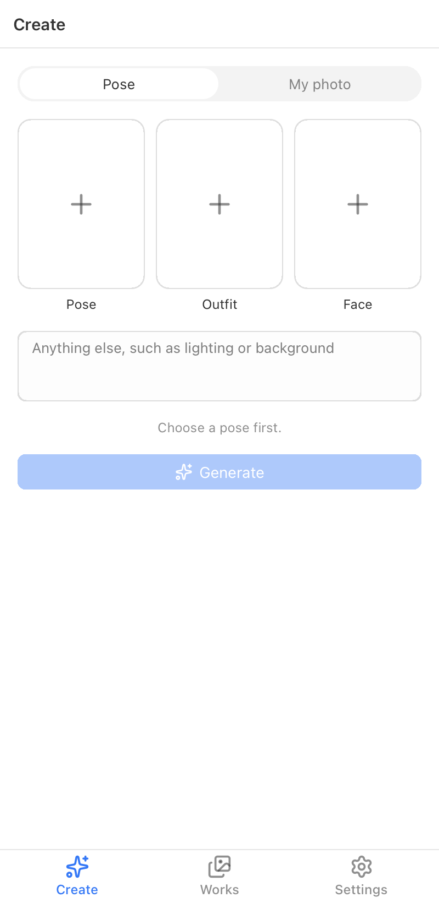
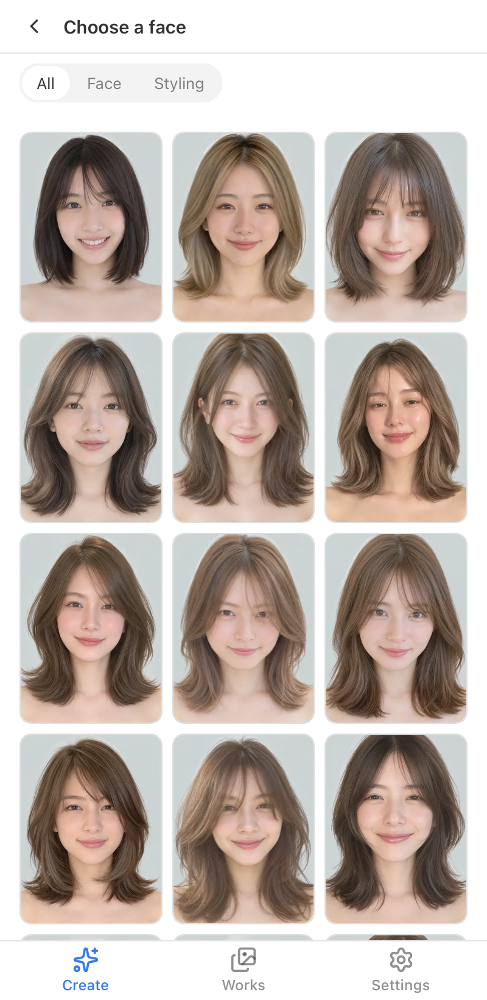
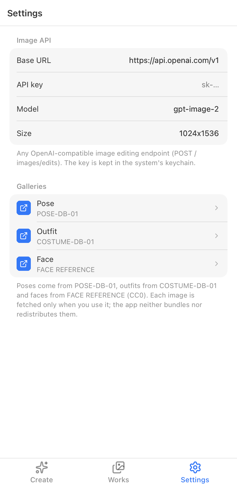

<p align="center">
  
</p>

<h1 align="center">Pose Studio</h1>

<p align="center">
  <strong>English</strong> |
  <a href="README.zh-CN.md">简体中文</a>
</p>

<p align="center">
  Put a pose, an outfit and a face together, or give your own photo another face, and let an image model draw the result. Built in Go with <a href="https://github.com/nsgo-dev/nsgo">NSGo</a>, which draws it with each platform's own views; one codebase builds for macOS, iOS, Android and Windows.
</p>

<p align="center">
  
  
  
</p>

## What it does

- **Pose + outfit + face.** Pick a pose (a faceless gray mannequin), an outfit (clothes with no one wearing them) and a face, and the app asks an image model for a photo of one adult person with that pose, outfit and face.
- **Face swap on your photo.** Switch the base to *My photo*, pick a picture from your library and a face. The pose, body, clothes, framing and background of your photo are kept. Outfits go on poses only, because the outfit gallery's terms forbid using its images to depict real people; the app enforces this in `Request.Validate` as well as in the UI.
- **Extra instructions.** Add a line such as lighting or background, sent along with the prompt.
- **Works.** Every result is kept on the device, with save, share and delete.
- **Bring your own model.** Any OpenAI-compatible image editing endpoint (`POST /images/edits`) works; the API key is kept in the system keychain.
- English and Simplified Chinese.

## Where the references come from

| Slot | Gallery | Terms |
| --- | --- | --- |
| Pose | [POSE-DB-01](https://ai-pose-gallery.pages.dev) | Free to use, commercial use included; redistribution and bulk or automated downloading are not allowed |
| Outfit | [COSTUME-DB-01](https://ai-costume-gallery.pages.dev) | Same as above |
| Face | [FACE REFERENCE](https://ai-portrait-gallery.pages.dev) | CC0 |

The images belong to the galleries' authors. This repository contains none of them, and the app follows the galleries' terms:

- It reads each gallery's index live. Thumbnails load from the gallery while you browse, as they would in a browser; the app keeps no copy of its own, beyond the platform's image cache.
- A full-size image is downloaded only when you press Generate, and only the ones you chose, one each.
- It leaves out the pose gallery's two-person and explicit lines and the outfit gallery's lingerie and "sexy" categories.

The pose and outfit galleries ask that their images are not used to depict real people or minors, or for anything offensive, and the face gallery that its faces are not used to impersonate real people. Those terms bind what you make with this app; see [NOTICE.md](NOTICE.md).

## How it works

```
gallery index (HTML / JS)  ──►  catalog: id, group, title, thumbnail, full image
                                   │
  you choose a pose with an outfit and a face, or a photo and a face
                                   │
full images (downloaded once) + your photo + prompt
                                   │
                POST {base URL}/images/edits  (multipart, image[] in order)
                                   │
          b64_json or url  ──►  saved in the app's data directory
```

The prompt numbers the images in the order they are sent and says what each one is for: the mannequin's pose and camera angle, or the photo to keep; the outfit to put on; the face and hair to use.

| File | What is in it |
| --- | --- |
| [`gallery.go`](gallery.go) | Reading the three galleries' indexes and what is left out |
| [`generate.go`](generate.go) | The prompt and the `/images/edits` request |
| [`works.go`](works.go) | Saving and listing results |
| [`app.go`](app.go) | The screens: Create, the pickers, a result, Works and Settings |
| [`locales/`](locales) | English and Chinese messages |
| [`tools/appicon`](tools/appicon) | Draws `assets/Icon.png` |

## Run it

Requires Go 1.27.4 or later. On a Mac, which also builds the iOS and Android apps:

```sh
git clone https://github.com/houko/nsgo-pose
cd nsgo-pose
go tool nsgo dev                     # this machine
go tool nsgo dev -lang zh-Hans       # in Chinese
go tool nsgo dev -target ios_simulator
go tool nsgo dev -target android     # a connected device or emulator
go tool nsgo build                   # packages for every target in nsgo.yaml, into dist/
```

`go tool nsgo doctor` says which targets this machine can build and run.

### Set up the image API

Open **Settings** and fill in:

| Field | Default | Notes |
| --- | --- | --- |
| Base URL | `https://api.openai.com/v1` | Any OpenAI-compatible API or gateway; the app appends `/images/edits` |
| API key | | Stored in the macOS / iOS keychain, Android Keystore or Windows Credential Manager |
| Model | `gpt-image-2` | A model that takes several reference images |
| Size | `1024x1536` | Passed as `size` |

Each Generate is one paid call to the API you configured. So far the request has been tested against the local fake in the tests, not against a real image API; reports of what a given model or gateway does with it are welcome.

## Platforms

| Platform | State |
| --- | --- |
| macOS | Runs; tested in a real window |
| iOS, Android, Windows | `nsgo build` packages them (an iOS Simulator app, an APK signed with the debug key, a Windows installer); not yet run on a device or simulator |
| Linux | Not in the build targets yet; NSGo supports it, untested here |
| Web | Not supported: the browser has no secure store for the API key (`cx.Secrets()` is unavailable there) |

## Privacy

- Your photo leaves the device only in the request to the API you set up, and only when you press Generate.
- The galleries see the requests for the thumbnails and images you open, as a browser visit would.
- Results stay in the app's data directory until you delete them.

## Development

```sh
go tool nsgo test .                                    # headless tests, with local fakes of the galleries and the API
go tool nsgo test -target macos .                      # the same tests in a real window
go tool nsgo check -target macos,ios,android,windows   # vet every target
go run ./tools/appicon                                 # redraw the icon
```

The tests never reach the network: `fixtures_test.go` serves made-up gallery pages in the galleries' formats and a fake `/images/edits`.

If a gallery changes its page format, the picker shows "Couldn't load the gallery" with the parser's error; the parsers are in `gallery.go`.

## License

The code is [MIT](LICENSE). The gallery images are not part of this repository and stay under their owners' terms.
