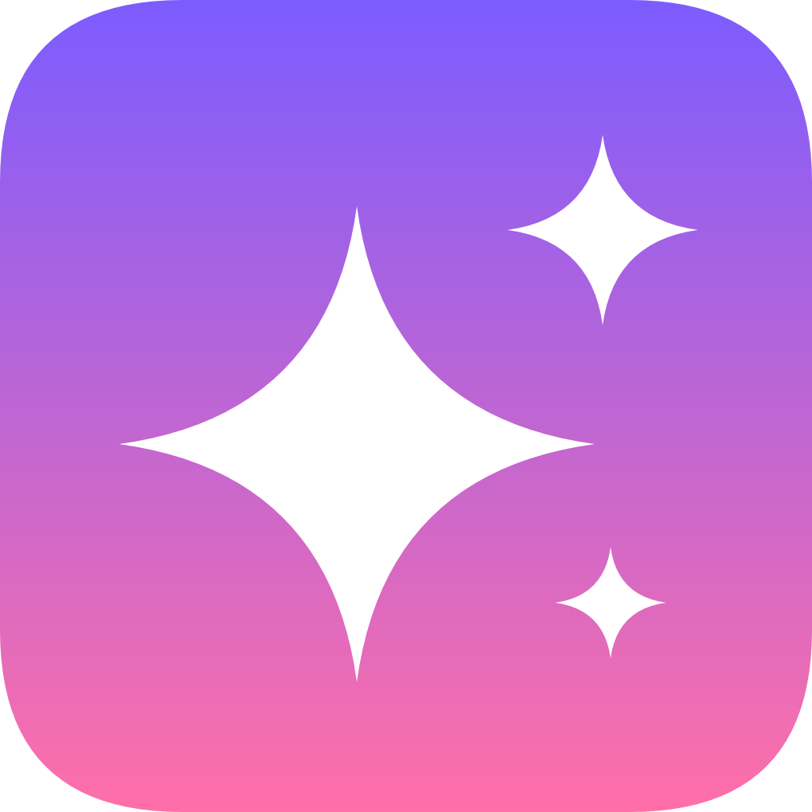
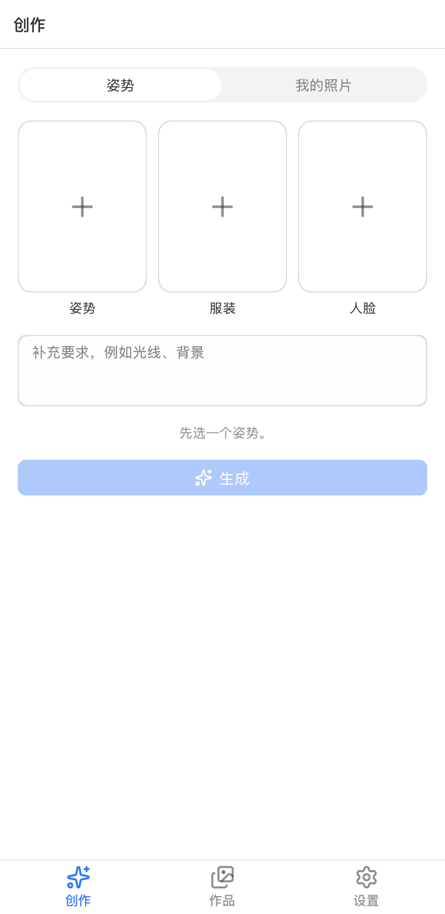
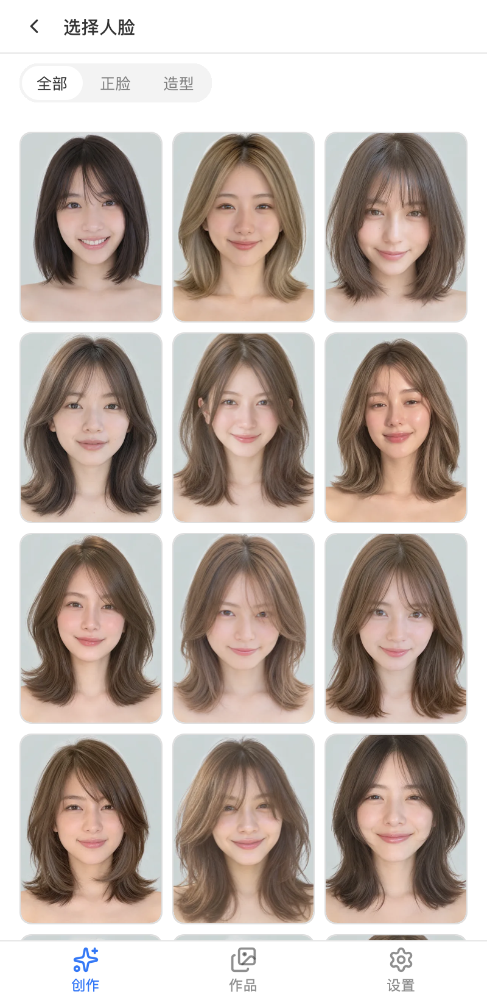
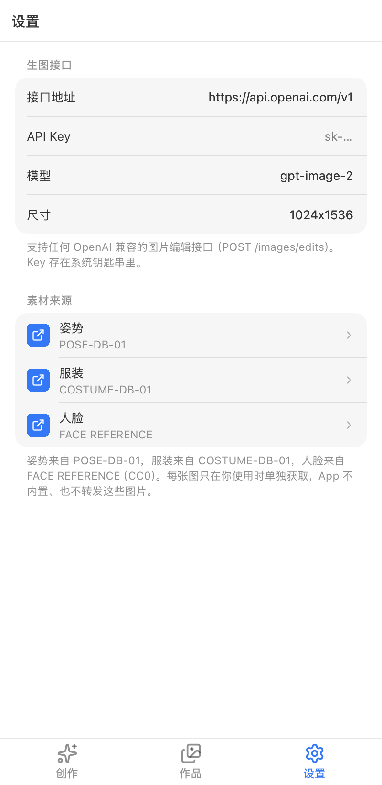

<p align="center">
  
</p>

<h1 align="center">换装换脸</h1>

<p align="center">
  <a href="README.md">English</a> |
  <strong>简体中文</strong>
</p>

<p align="center">
  把姿势、服装和人脸组合在一起，或者给自己的照片换一张脸，交给图像模型画出结果。用 Go 和 <a href="https://github.com/nsgo-dev/nsgo">NSGo</a> 写成，界面由各平台自己的原生控件绘制；同一份代码构建 macOS、iOS、Android 和 Windows 版本。
</p>

<p align="center">
  
  
  
</p>

## 功能

- **姿势 + 服装 + 人脸。** 选一个姿势（无脸的灰色人偶）、一套服装（没有人穿的衣服）和一张脸，App 让图像模型生成一张具备这个姿势、服装和脸的成年人照片。
- **给自己的照片换脸。** 底图切到「我的照片」，从相册选一张，再选一张脸。照片里的姿势、体型、衣服、构图和背景保持不变。服装只能用在姿势上，因为服装库的条款禁止用它的图片表现真实的人；这一点除了界面，`Request.Validate` 里也做了限制。
- **补充要求。** 写一句光线、背景之类的要求，随 prompt 一起发送。
- **作品。** 每张结果都保存在本机，可以保存、分享、删除。
- **自带模型。** 支持任何 OpenAI 兼容的图片编辑接口（`POST /images/edits`）；API Key 存在系统钥匙串里。
- 界面有英文和简体中文。

## 素材来源

| 槽位 | 图库 | 条款 |
| --- | --- | --- |
| 姿势 | [POSE-DB-01](https://ai-pose-gallery.pages.dev) | 免费使用，包括商用；禁止再分发，禁止批量或用工具自动下载 |
| 服装 | [COSTUME-DB-01](https://ai-costume-gallery.pages.dev) | 同上 |
| 人脸 | [FACE REFERENCE](https://ai-portrait-gallery.pages.dev) | CC0 |

图片归各图库作者所有。本仓库不包含任何一张，App 也遵守图库的条款：

- 每次都在线读取图库的目录。浏览时缩略图从图库加载，和用浏览器看一样；除了系统的图片缓存，App 自己不保存副本。
- 只有按下「生成」时才下载原图，而且只下载你选中的那几张，每张一次。
- 不提供姿势库里的双人和露骨分类，也不提供服装库里的内衣和「セクシー」分类。

姿势库和服装库要求不要用它们的图片表现真实的人或未成年人，也不要用于违反公序良俗的用途；人脸库要求不要用来冒充真实的人。用这个 App 做出来的东西同样受这些条款约束，详见 [NOTICE.md](NOTICE.md)。

## 工作原理

```
图库目录（HTML / JS）  ──►  条目：id、分类、标题、缩略图、原图
                                │
     选「姿势 + 服装 + 人脸」，或者「照片 + 人脸」
                                │
原图（各下载一次）+ 你的照片 + prompt
                                │
            POST {接口地址}/images/edits（multipart，image[] 按顺序）
                                │
       b64_json 或 url  ──►  保存到 App 的数据目录
```

prompt 按图片发送的顺序给它们编号，并说明每张的用途：人偶的姿势和机位，或者要保留的照片；要穿上的服装；要用的脸和发型。

| 文件 | 内容 |
| --- | --- |
| [`gallery.go`](gallery.go) | 读取三个图库的目录，以及过滤掉哪些内容 |
| [`generate.go`](generate.go) | prompt 和 `/images/edits` 请求 |
| [`works.go`](works.go) | 保存和列出结果 |
| [`app.go`](app.go) | 各个页面：创作、选择页、结果、作品、设置 |
| [`locales/`](locales) | 英文和中文文案 |
| [`tools/appicon`](tools/appicon) | 绘制 `assets/Icon.png` |

## 运行

需要 Go 1.27.4 或更高版本。在 Mac 上（也能构建 iOS 和 Android 版本）：

```sh
git clone https://github.com/houko/nsgo-pose
cd nsgo-pose
go tool nsgo dev                     # 本机
go tool nsgo dev -lang zh-Hans       # 中文界面
go tool nsgo dev -target ios_simulator
go tool nsgo dev -target android     # 已连接的设备或模拟器
go tool nsgo build                   # 打包 nsgo.yaml 里列出的所有平台，输出到 dist/
```

`go tool nsgo doctor` 会告诉你这台机器能构建、运行哪些平台。

### 配置生图接口

打开「设置」，填写：

| 字段 | 默认值 | 说明 |
| --- | --- | --- |
| 接口地址 | `https://api.openai.com/v1` | 任何 OpenAI 兼容的接口或网关；App 会在后面拼上 `/images/edits` |
| API Key | | 存在 macOS / iOS 钥匙串、Android Keystore 或 Windows 凭据管理器里 |
| 模型 | `gpt-image-2` | 需要支持多张参考图的模型 |
| 尺寸 | `1024x1536` | 作为 `size` 参数传入 |

每按一次「生成」，就是对你配置的接口的一次付费调用。目前这个请求只在测试里的本地模拟接口上验证过，还没有对真实的生图接口测试过；欢迎反馈各个模型或网关的实际表现。

## 平台

| 平台 | 状态 |
| --- | --- |
| macOS | 可以运行；在真实窗口里测试过 |
| iOS、Android、Windows | `nsgo build` 能打包（iOS 模拟器 App、用调试密钥签名的 APK、Windows 安装程序）；还没有在设备或模拟器上运行过 |
| Linux | 还不在构建目标里；NSGo 支持，这里没测过 |
| 网页 | 不支持：浏览器里没有安全存放 API Key 的地方（`cx.Secrets()` 在网页上不可用） |

## 隐私

- 你的照片只会在按下「生成」时，随请求发给你配置的接口。
- 图库会看到你打开的缩略图和原图的请求，和用浏览器访问一样。
- 结果保存在 App 的数据目录里，直到你删除。

## 开发

```sh
go tool nsgo test .                                    # headless 测试，图库和接口都用本地模拟
go tool nsgo test -target macos .                      # 同一套测试在真实窗口里跑
go tool nsgo check -target macos,ios,android,windows   # 对每个平台做 vet
go run ./tools/appicon                                 # 重新绘制图标
```

测试不访问网络：`fixtures_test.go` 按图库的格式提供虚构的页面数据，以及一个模拟的 `/images/edits`。

如果哪个图库改了页面格式，选择页会显示「图库加载失败」和解析器的报错；解析代码在 `gallery.go`。

## 许可

代码使用 [MIT](LICENSE) 许可。图库的图片不属于本仓库，仍受其所有者的条款约束。
